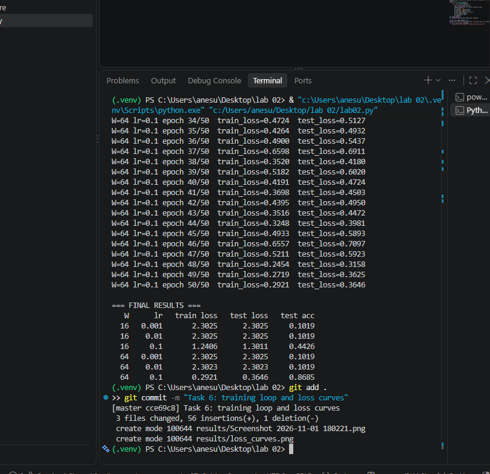
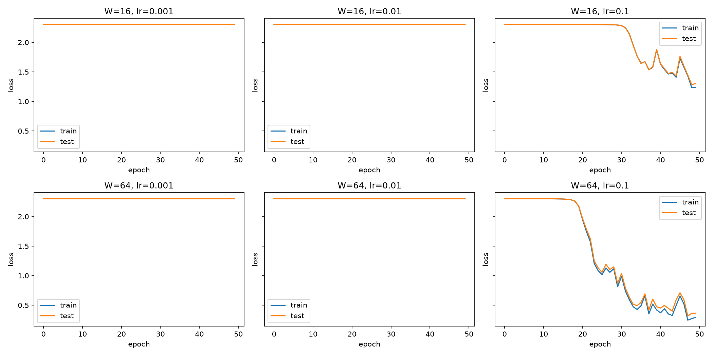
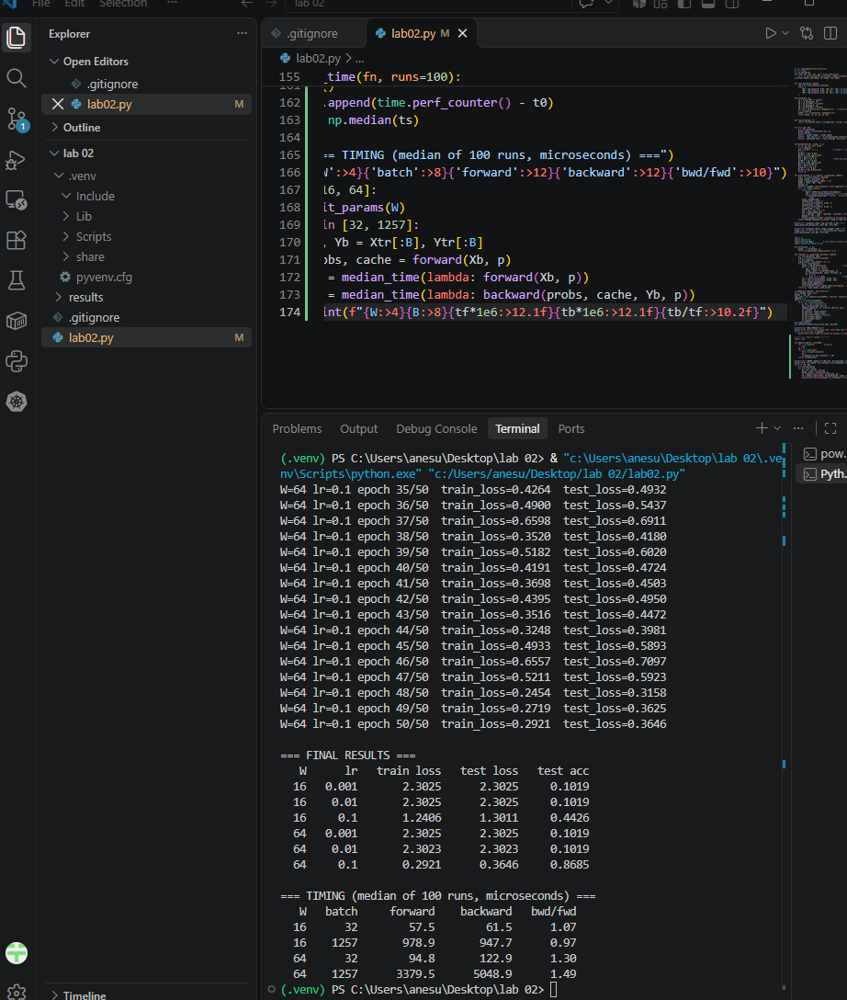

# Lab 2: A neural network from scratch (NumPy)

Two-hidden-layer MLP (64 → W → ReLU → W → ReLU → 10 → softmax) on `sklearn.datasets.load_digits`, implemented from scratch with NumPy: forward pass, cross-entropy loss, hand-derived backpropagation, numerical gradient checking, mini-batch SGD, and timing.

**Environment:** Python 3.11.9, NumPy, scikit-learn, Matplotlib.
**Run:** `python lab02.py` (prints all checks and saves `results/loss_curves.png`).

## 1. Dataset
Inputs scaled by dividing by 16, labels one-hot encoded, 70/30 stratified split with `random_state=42`.
Shapes: X_train (1257, 64), X_test (540, 64), Y_train (1257, 10), Y_test (540, 10).

## 2. Network design (on paper)
Weight shapes: W1 (64, W), W2 (W, W), W3 (W, 10). Bias shapes: b1 (W,), b2 (W,), b3 (10,). Weights initialised from N(0, 0.01), biases zero. Used W = 16 and W = 64.

## 3-4. Forward pass and cross-entropy loss
Output shape is (batch, 10) and each row sums to 1 within 1e-6. The untrained loss is 2.3026 for both widths, matching ln(10).

## 5. Backpropagation and gradient check
Gradients were derived by hand with the chain rule (softmax + cross-entropy gives dz3 = (p - Y)/n; ReLU derivative is 1 where z > 0).

Numerical check: 10 random weights (zero-gradient weights skipped), nudged by ±1e-5, relative error compared with 1e-6.

| Initialisation | Passed | Typical relative error |
|---|---|---|
| Lab init N(0, 0.01) | 4/10 | ~3e-7 to 3e-6 |
| Weights scaled x10 | **10/10** | ~1e-9 to 6e-8 |

With the lab's N(0, 0.01) init, the true gradients are tiny (~1e-5). Float64 roundoff in the finite difference (~1e-11) is then a visible fraction of the gradient, so the relative error lands just above 1e-6 even though analytic and numerical values agree to 5-6 digits. At 10x weight scale the gradients are larger and the check passes 10/10, which validates the backprop implementation.

## 6. Training
Mini-batch size 32, 50 epochs, reshuffled every epoch, plain SGD.

| W | lr | Final train loss | Final test loss | Test accuracy |
|---|---|---|---|---|
| 16 | 0.001 | 2.3025 | 2.3025 | 10.19% |
| 16 | 0.01 | 2.3025 | 2.3025 | 10.19% |
| 16 | 0.1 | 1.2406 | 1.3011 | 44.26% |
| 64 | 0.001 | 2.3025 | 2.3025 | 10.19% |
| 64 | 0.01 | 2.3023 | 2.3023 | 10.19% |
| 64 | 0.1 | 0.2921 | 0.3646 | **86.85%** |

**Observations**
- With N(0, 0.01) init the signal shrinks at every layer, so gradients are very small. At lr = 0.001 and 0.01 the loss stays at ln(10) = 2.3025 (chance accuracy) for all 50 epochs: the network is stuck on a plateau.
- Only lr = 0.1 takes steps large enough to leave the plateau.
- The wider network learns much faster: at lr = 0.1, W = 64 reaches 86.85% while W = 16 reaches 44.26% and is still improving after 50 epochs.
- At lr = 0.1 the loss is noisy from epoch to epoch (large step relative to the loss surface), so more epochs or a decaying learning rate would help.
- Best configuration: W = 64, lr = 0.1.

## 7. Timing
Median of 100 runs (after warm-up), in microseconds.

| W | batch | forward | backward | backward / forward |
|---|---|---|---|---|
| 16 | 32 | 57.5 | 61.5 | 1.07 |
| 16 | 1257 | 978.9 | 947.7 | 0.97 |
| 64 | 32 | 94.8 | 122.9 | 1.30 |
| 64 | 1257 | 3379.5 | 5048.9 | 1.49 |

**Which dominates?** Once the matrices are large, backward dominates (1.49x at W = 64, batch 1257). Forward uses 3 matrix multiplications (about 8.8k multiply-adds per sample at W = 64). Backward uses 5 (about 13.6k): each layer needs a weight gradient (aᵀ·dz), and the two hidden layers also need a gradient passed back (dz·Wᵀ). The first layer needs no input gradient, so the ratio is about 1.5 rather than 2, which matches the measured 1.49. At W = 16 the matrices are small, so Python/NumPy call overhead and element-wise operations (ReLU masks, softmax, sums) dominate and the ratio is about 1.

## Files
- `lab02.py`: all code (Tasks 1-7)
- `results/`: loss curves, gradient check, timing and the paper photos